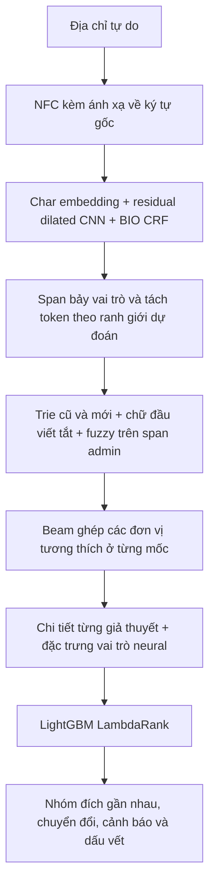

# Char-CNN + CRF và LightGBM Ranker — bản thử CPU

Triển khai ngày 29/10/2026. Đây là nhánh thử nghiệm có thể train, nạp checkpoint
và chạy toàn pipeline; mặc định CLI vẫn là luật v3 để đối chứng.
Không sử dụng PhoBERT, GPU, LLM hay API ngoài khi train hoặc suy luận.

## Pipeline đã triển khai



- Bảy vai trò: số nhà, ngõ/hẻm, thôn/tổ, đường, xã/phường, huyện/quận,
  tỉnh/thành. BIO ở mức ký tự: 15 nhãn gồm O. Không có nhãn mốc chung
  cho cả câu; mỗi ứng viên hành chính giữ `(mốc, mã)` riêng.
- Embedding 64, kênh CNN 96; sáu block residual, mỗi block hai Conv1D
  kernel 3, dilation 1/2/4/8/16/32; dropout 0.15. Trường tiếp nhận 253
  ký tự. Tổng cộng **351.246 tham số** ở checkpoint đầu tiên.
- CRF được train cùng CNN, có ràng buộc BIO hợp lệ khi train và Viterbi.
  Phần hành chính chưa căn chỉnh được dùng nhãn một phần, cho phép
  O/nhãn hành chính thay vì ép thành O. Loss: partial CRF NLL chia độ dài
  cộng 0.2 cross-entropy trên ký tự có một nhãn được phép.
- Tensor padding được mask sau mỗi convolution; kết quả một câu không
  thay đổi chỉ vì được đặt trong batch có câu dài hơn.
- NFC giữ ánh xạ cụm dấu phân rã về toàn đoạn gốc. Ranh giới dự đoán có
  thể chia token như `151Đ.` thành `151` và `Đ`; không sửa tokenizer mặc định.
- Neural chạy một lần trên chuỗi. Các giả thuyết hành chính sau đó che
  các token đã dùng và dựng chi tiết. Chưa giải mã lại CRF có điều kiện
  trên từng giả thuyết, chưa sinh nhiều phương án BIO.
- Tra cứu mở rộng lấy chữ đầu từ danh mục hành chính, tìm Levenshtein 1
  trên span hành chính dự đoán có tối thiểu bốn ký tự. Giới hạn 12 span,
  64 hit/span; quá giới hạn hit có cảnh báo. Giữ bộ tra trie trước đó.
- Điểm emission là log-softmax trước CRF, không phải marginal CRF hay
  xác suất đúng cả địa chỉ. Ranker dùng điểm này cùng các đặc trưng cấu
  trúc; không đưa mã/tên địa phương hoặc nhãn tham chiếu vào feature.
- Beam vẫn dùng điểm tay để giữ ứng viên trước ranker. Ranker chỉ chọn
  trong các phương án còn lại; thống kê có oracle beam để thấy giới hạn này.
- Ranker: LambdaRank, 100 cây, tối đa 15 lá/cây, sâu 4, learning rate 0.05.
  Mỗi địa chỉ là một query; các phương án cùng kết quả tham chiếu đều
  nhận nhãn dương. Nhóm không có phương án admin đúng hoặc không có
  cặp dương/âm bị loại khỏi train ranker.
- Ngưỡng điểm gần nhau của ranker cố định 0.05, **chưa hiệu chỉnh xác suất**.
  Mô hình sai checksum hoặc khác danh mục so với metadata sẽ bị từ chối.

## Dữ liệu và phép đo

Run đầu tiên: `mo_hinh/thu_nghiem/char_v1_01/`.

- Dùng snapshot train/dev đã đóng băng của thí nghiệm CRF, cộng bản sao
  sáu CSV danh mục. Không đọc nhãn test cuối, không sửa dữ liệu agy đang làm.
- Không sinh thêm câu train. Chi tiết gốc kế thừa các mẫu đã qua lọc căn
  chỉnh CRF. Chi tiết bổ sung dùng offset ký tự đã bàn giao, kiểm tra lại
  token/BIO/span trước khi dùng; không cần ép vào tokenizer runtime cũ.
- Có **6.010 mẫu train**: **4.841 cho CNN**, **1.169 riêng cho ranker**.
  Tách theo nhóm liên thông của họ che số nhà và ID mẫu cha có khai báo.
  CNN không train trên các nhóm ranker. Không dùng dev để chọn checkpoint.
- So với bộ CRF 5.966 mẫu, tiếp nhận thêm 44 span train trước đây cắt
  giữa token runtime. Điều này xác nhận khả năng đọc dữ liệu ký tự,
  không tự chứng minh dự đoán các ca đó là đúng.
- Nhãn hành chính được căn chỉnh yếu từ tên đơn vị ứng với mã tham chiếu
  xuất hiện duy nhất trong input; không lấy đầu ra bộ chuẩn hóa làm nhãn.
  Không căn chỉnh được thì để nhãn một phần. Nhãn máy/synthetic vẫn có thể sai.
- Tên chuẩn bổ sung không khớp danh mục thì không được dùng train ranker.
- Dev gốc có 1.136 câu cho end-to-end, trong đó 1.026 có nhãn chi tiết
  đủ điều kiện đo span. Dev khó có 464 câu cho cả hai phép đo.
- Huấn luyện CNN 12 vòng cố định, seed 20261029, AdamW lr 0.002,
  batch 32, hai luồng CPU: **263,27 giây**, checkpoint **1.419.365 byte**.
  Đây là số đo thực tế của cấu hình nhỏ này; dự trù 15–60 phút trước đó
  đã cao hơn thời gian đo. Train peak working set toàn tiến trình 534,6 MiB.

Kết quả đầu tiên: CNN + ranker khớp 893/1.136 câu dev gốc (78,61%) và
280/464 câu dev khó (60,34%); CRF cũ kết hợp tương ứng 895 và 274 câu.
CNN + điểm tay đạt 886 và 281 câu: ranker chưa cải thiện đồng đều.
Mean end-to-end CNN + ranker 15,70/17,38 ms, P95 23,46/39,34 ms trên
dev gốc/dev khó. RAM suy luận tiến trình riêng khoảng 249,9 MiB working set
sau nạp và 21 lần gọi; private committed khoảng 606,9 MiB, có cả runtime.
61 bài test đạt. Chi tiết tổng hợp ở `TONG_KET.md` cùng thư mục báo cáo.

Đọc kết quả từng trường, span, ứng viên, oracle beam, end-to-end và độ trễ
tại `danh_gia/ket_qua/char_v1_01_cuoi/BAO_CAO.md` và `thong_ke.json`.
JSONL có đầy đủ input, nhãn tham chiếu và output; `so_sanh_loi.csv` có các
ca sai và thay đổi so với CRF. Mọi độ khớp hiện tại là với nhãn máy/tổng hợp.
Admin span chỉ đo recall trên phần nhãn căn chỉnh yếu, không báo precision
giả bằng cách coi vùng chưa gán nhãn là âm.

## Cài môi trường CPU

Chạy từ thư mục gốc dự án trong PowerShell:

```powershell
py -3.12 -m venv .venv-neural
.\.venv-neural\Scripts\python.exe -m pip install torch==2.15.0 --index-url https://download.pytorch.org/whl/cpu
.\.venv-neural\Scripts\python.exe -m pip install -r requirements-neural.txt
```

## Dùng checkpoint đã train

```powershell
.\.venv-neural\Scripts\python.exe -X utf8 -B -m src 'Số 12, Đường Lê Lợi, Phường Trúc Bạch, Quận Ba Đình, Hà Nội' --char-model mo_hinh/thu_nghiem/char_v1_01/char_cnn.pt --ranker mo_hinh/thu_nghiem/char_v1_01/ranker.txt --threads 1
```

Bỏ `--ranker` để chạy đối chứng CNN với điểm tay. Không kết hợp
`--char-model` với `--crf-model`. Địa chỉ dài hơn 2.048 ký tự bị từ chối
rõ ràng; không âm thầm cắt đầu vào.

API Python tương đương:

```python
from src.char_cnn import BoTachCharCNN
from src.chuan_hoa import BoChuanHoa
from src.danh_muc import DanhMuc
from src.xep_hang import BoXepHang

extractor = BoTachCharCNN('mo_hinh/thu_nghiem/char_v1_01/char_cnn.pt')
dm = DanhMuc()
ranker = BoXepHang(
    'mo_hinh/thu_nghiem/char_v1_01/ranker.txt',
    extractor.ma_bam, dm.ma_bam,
)
normalizer = BoChuanHoa(danh_muc=dm, bo_tach=extractor, bo_xep_hang=ranker)
result = normalizer.chuan_hoa('12 Lê Lợi, Phường Trúc Bạch, Hà Nội')
```

## Train và đo lại

Lệnh `all` cần thư mục run chưa tồn tại; không ghi đè run cũ:

```powershell
.\.venv-neural\Scripts\python.exe -X utf8 -B -m danh_gia.huan_luyen_char --run-dir mo_hinh/thu_nghiem/char_v1_lan_moi --epochs 12 --threads 2
.\.venv-neural\Scripts\python.exe -X utf8 -B -m danh_gia.do_char --run-dir mo_hinh/thu_nghiem/char_v1_lan_moi --output danh_gia/ket_qua/char_v1_lan_moi
.\.venv-neural\Scripts\python.exe -X utf8 -B -m danh_gia.kiem_tra_char --run-dir mo_hinh/thu_nghiem/char_v1_lan_moi --output danh_gia/ket_qua/char_v1_lan_moi
.\.venv-neural\Scripts\python.exe -X utf8 -B -m danh_gia.do_ram_char --run-dir mo_hinh/thu_nghiem/char_v1_lan_moi --output danh_gia/ket_qua/char_v1_lan_moi/RAM_SUY_LUAN.json
.\.venv-neural\Scripts\python.exe -X utf8 -B -m unittest tests.test_char tests.test_pipeline tests.test_pipeline_v3 tests.test_crf tests.test_danh_gia
```

Các stage `prepare`, `cnn`, `ranker` cho phép chạy lần lượt khi cần kiểm
tra dữ liệu. `cnn`/`ranker` ghi checkpoint trong run đã chuẩn bị, nên dùng
run mới nếu muốn giữ nguyên một lần thử. Trước khi đo, chờ train hoàn tất
để tránh đo tốc độ trong lúc CPU đang huấn luyện.

## Phần còn thiếu

Chưa có danh mục đường/thôn được chứng thực theo địa phương, vì vậy
chưa phục hồi dấu hoặc mở rộng viết tắt tên đường như `NTMK` một cách
có căn cứ. CNN nhận ra vai trò không đồng nghĩa biết tên chuẩn.
Chưa có benchmark Transformer, distillation, ONNX/INT8 hay tối ưu server.
Chưa được coi là đạt 95% hoặc thay bản mặc định chỉ vì đã train xong.
