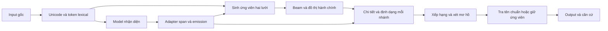

# Module và số đo riêng từng tầng

Cập nhật 29/10/2026. Đây là bản đồ triển khai hiện tại; sơ đồ CRF/logistic
regression trong tài liệu thiết kế cũ được giữ làm lịch sử.

## Ranh giới code

| Tầng | Module sở hữu | Đầu ra / trách nhiệm |
|---|---|---|
| Tiền xử lý biểu diễn | `src/tien_xu_ly.py` | Token lexical, offset gốc, NFC và ánh xạ ký tự. Không gán vai trò hoặc mã. |
| Từ vựng tiền tố | `src/quy_tac.py` | Loại hành chính/chi tiết, cách gõ Telex của tiền tố. Không chọn tên riêng/mã đích. |
| Schema nhãn | `src/nhan.py` | 7 vai trò, BIO, đọc span. Không phụ thuộc kiến trúc NN. |
| Nhận diện model | `src/char_cnn.py`, `src/videberta.py`, `src/crf_chi_tiet.py` | Emission/nhãn vai trò. Không tự chứng thực tên chuẩn hoặc địa giới. |
| Adapter neural | `src/ngu_canh_neural.py` | Span/emission thành lưới token có offset; điểm tương thích vai trò cho bước ghép. Không chạy mạng. |
| Sinh ứng viên | `src/tim_kiem.py`, `src/tra_cuu_neural.py` | Tra hai lưới, tên/alias/fuzzy, giữ mốc và span. |
| Đồ thị hành chính | `src/danh_muc.py`, `src/chuyen_doi.py` | Quan hệ nguồn/đích theo mốc, xã chia nhiều đích. |
| Sinh phương án | `src/giai_ma.py` | Beam trên ứng viên và quan hệ địa bàn. |
| Định dạng span | `src/dinh_dang.py` | Giá trị từ span/loại đã gán; không chạy model hoặc tra mã hành chính. |
| Xếp hạng | `src/xep_hang.py` | Chấm giả thuyết đã sinh; không bổ sung đáp án vắng trong beam. |
| Khôi phục tên | `src/chuan_ten_duong.py` | Tra giá trị/ứng viên tên theo tỉnh, nguồn và xung đột dấu. |
| Giải thích/hợp đồng | `src/hop_dong.py` | Quan sát, thao tác, căn cứ, giả thuyết; không phải một model mới. |
| Điều phối | `src/chuan_hoa.py` | Ghép các tầng và quyết định output/mơ hồ theo chế độ. |

Đã chuyển thực sự NFC/offset, schema nhãn, adapter neural và formatter về
các module trên. Giữ re-export ở vị trí cũ để các lệnh/train/checkpoint cũ
tiếp tục dùng được. `LinearCRF` vẫn là thành phần NN dùng chung trong
`char_cnn.py`, được ViDeBERTa dùng lại; không phải ViDeBERTa chạy qua CNN.

## 1. Tiền xử lý: đã bổ sung đo riêng

Đo mới trên toàn bộ 1.136 dev gốc + 464 dev khó:

| Chỉ số cấu trúc | Dev gốc | Dev khó |
|---|---:|---:|
| Offset token hợp lệ, không chồng | 1.136/1.136 | 464/464 |
| Giữ mọi ký tự không phải khoảng trắng | 1.136/1.136 | 464/464 |
| NFC và ánh xạ về input hợp lệ | 1.136/1.136 | 464/464 |
| Span tham chiếu có đầu/cuối trùng biên token lexical | 1.921/1.921 | 904/928 — 97,414% |
| Câu có toàn bộ biên span trùng token lexical | 1.026/1.026 | 452/464 — 97,414% |

**Không gọi các số này là 100% chính xác ngữ nghĩa tiền xử lý.** Có nhiều
cách tokenization hợp lệ; 24 span ở 12 câu khó cắt trong token lexical.
Model ký tự vẫn xử lý được ranh giới đó. Bộ tra hai lưới giữ cách chia gốc
và cách chia model để không biến một ranh giới sai thành quyết định cuối.

## 2. Model: có số riêng, không lấy end-to-end làm điểm model

F1 micro raw char span, chỉ **4 trường chi tiết**: số nhà, ngõ/hẻm, thôn/xóm,
đường. Không gồm tra mã, đổi địa giới, định dạng giá trị hoặc khôi phục dấu.
Tính lại từ prediction đã lưu của các checkpoint không đổi:

| Model | F1 dev gốc, 1.026 câu có span | F1 dev khó, 464 câu |
|---|---:|---:|
| CNN | 98,132% | 98,761% |
| ViDeBERTa | 97,566% | 98,925% |

| Model | Câu đúng toàn bộ span chi tiết — gốc | Khó |
|---|---:|---:|
| CNN | 988/1.026 — 96,296% | 453/464 — 97,629% |
| ViDeBERTa | 974/1.026 — 94,932% | 456/464 — 98,276% |

F1 đường riêng: CNN 97,792/97,685%; ViDeBERTa 97,155/98,122%.
Dev khó không có span ngõ/hẻm và chỉ có12 span thôn/xóm, nên chưa đủ để
đánh giá đều mọi loại. Hành chính của NN hiện có nhãn căn chỉnh yếu/recall
một phần; **chưa có F1/accuracy ngữ nghĩa đầy đủ cho cả7 vai trò**.

## 3. Định dạng: thêm phép đo khi cấp span tham chiếu hoàn hảo

Không gọi model; đưa đúng đoạn tham chiếu vào formatter, chưa tra từ điển tên.

| So giá trị định dạng với canonical reference không trống | Dev gốc | Dev khó |
|---|---:|---:|
| Khớp nguyên giá trị | 1.820/1.921 — 94,742% | 803/910 — 88,242% |
| Khớp sau bỏ dấu | 1.909/1.921 — 99,375% | 876/910 — 96,264% |

18 span khó có canonical reference trống được ghi riêng, không ép một tên
để chấm. Phép đo này là chẩn đoán **đầu ra khi span hoàn hảo**, không phải
gold độc lập về formatter: tên viết tắt/không dấu còn cần bước khôi phục,
và reference vẫn có thể yếu/sai. Không đổ toàn bộ chênh lệch cho formatter.

## 4. Ghép/tra cứu/xếp hạng và end-to-end

Các lượt trước có độ phủ ứng viên/beam và oracle hậu kiểm; không phải
accuracy độc lập của từng module. Sau sửa hai lưới mới nhất, đã đo lại
end-to-end nhưng chưa chạy lại toàn bộ oracle từng tầng. Chưa có gold riêng
đủ tin cậy cho quyết định tên chuẩn/mơ hồ của bộ khôi phục hoặc ranker.

Bản đo end-to-end mới nhất trước refactor module:

| Cấu hình | Dev gốc | Dev khó |
|---|---:|---:|
| CNN + ranker + tra tên train + bảo vệ đường | 82,835% | 72,629% |
| ViDeBERTa + điểm tay + cùng các bước sau | 81,514% | 73,276% |

Đây là nhãn máy/tổng hợp trên dev đã dùng phát triển. Các số không được
nhân với nhau: tập con, đơn vị đo và các tầng phụ thuộc khác nhau.

## Kiểm chứng refactor và nguồn số liệu

Không thay thuật toán/weights trong lượt tách module. Kiểm thử hồi quy và
kiểm tra parity thực tế trên mỗi checkpoint:8 câu raw span +4 câu end-to-end,
kết quả giữ nguyên. Chưa chạy lại full inference sau refactor; F1 được tính
lại từ prediction đầy đủ đã lưu để tiết kiệm chi phí.

- [Thống kê từng module](../danh_gia/ket_qua/tung_module_v1_01/thong_ke.json).
- [Parity sau refactor](../danh_gia/ket_qua/tung_module_v1_01/KIEM_TRA_REFACTOR.json).
- [Log kiểm thử](../danh_gia/ket_qua/tung_module_v1_01/KIEM_THU.txt).
- [Script đo](../danh_gia/do_tung_module.py).
- [End-to-end gần nhất](SUA_TRA_CUU_HANH_CHINH_V1.md).
