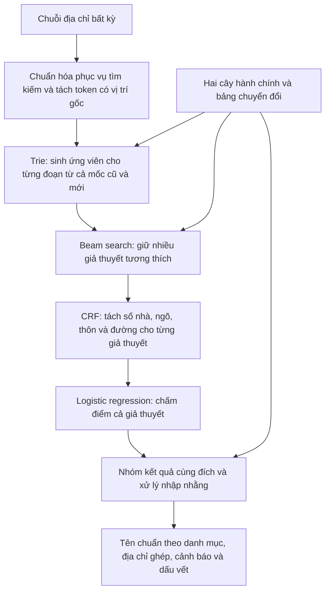

# Pipeline lõi chuẩn hóa địa chỉ

**Bản đồ triển khai và số đo hiện tại:** [Module và số đo riêng từng tầng](MODULE_VA_SO_DO.md).
Các sơ đồ CRF/logistic regression bên dưới là lịch sử thiết kế.

**Cập nhật triển khai:** đã bổ sung nhánh [Char-CNN + CRF bảy vai trò và LightGBM Ranker](THU_NGHIEM_CHAR_CNN_V1.md) chạy CPU. Đây là thiết kế thử nghiệm tiếp theo; sơ đồ CRF bốn vai trò/logistic regression bên dưới giữ làm lịch sử thiết kế, không phải mô tả nhánh neural hiện tại.

Bản thiết kế ngày 29/10/2026, kế thừa pipeline đã bàn trong session Claude và bổ sung yêu cầu đầu vào trộn mốc. Bản mặc định dùng luật v3 và điểm tay. Đã [huấn luyện thử hai CRF CPU](THU_NGHIEM_CRF_V1.md), có adapter tách chi tiết và chế độ giữ ứng viên để CRF tham gia trước bộ lọc vai trò. Logistic regression chưa huấn luyện; sơ đồ bên dưới là thiết kế đích, chưa phải toàn bộ thành phần đã hoàn thành.

## 1. Đầu vào và đầu ra

Đầu vào là **một chuỗi địa chỉ tự do**, có thể trộn tên hành chính cũ và mới ngay trong cùng chuỗi, thiếu cấp, đảo thứ tự, viết tắt, mất dấu hoặc sai chính tả. Không yêu cầu người dùng khai báo mốc hoặc cấu trúc trước.

Đầu ra theo mốc 01/07/2025: số nhà, ngõ/ngách/hẻm, thôn/xóm, đường, xã/phường và tỉnh; kèm mã, địa chỉ ghép, cảnh báo, các xã mới ứng viên khi cần và dấu vết quyết định. Huyện cũ được dùng làm bằng chứng xác định, không xuất trong địa chỉ đích.

## 2. Sơ đồ xử lý một địa chỉ

Danh mục, cây, bảng chuyển đổi, trie và mô hình được nạp một lần lúc khởi động. Sơ đồ trên bắt đầu khi hệ thống đã sẵn sàng nhận chuỗi.

## 3. Vai trò của các thuật toán và mô hình

| Thành phần | Lựa chọn dự kiến | Nhiệm vụ |
|---|---|---|
| Sinh ứng viên hành chính | Trie và tìm gần đúng theo khoảng cách chỉnh sửa | Đưa ra các đơn vị có thể khớp mỗi đoạn, giữ mốc và mã |
| Kiểm tra hành chính | Quan hệ cha–con và bảng chuyển đổi | Loại các tổ hợp không nhất quán hoặc ghi nhận phần bằng chứng mâu thuẫn |
| Tìm tổ hợp | Beam search | Giữ một số giả thuyết tốt để tránh xét toàn bộ tổ hợp |
| Tách phần chi tiết | Linear-chain CRF với đặc trưng token/ký tự | Gán nhãn số nhà, ngõ/ngách/hẻm, thôn/xóm, đường và phần chưa phân loại |
| Xếp hạng cách hiểu toàn địa chỉ | Logistic regression | Chấm các đặc trưng của cả giả thuyết để chọn kết quả phù hợp |
| Hiển thị và chuyển đổi cuối | Tra danh mục và luật có căn cứ | Xuất tên chính thức, quyết định trường xác định được, giữ ứng viên/cảnh báo |

**Bộ mô hình học máy dự kiến là CRF + logistic regression.** Trie và beam search là thuật toán tìm kiếm, không phải mô hình đã học. Hiệu quả của lựa chọn này phải được kiểm chứng trên tập phát triển và so với bản dùng luật/điểm tay.

## 4. Chi tiết các bước

### Bước 1 — Chuẩn hóa phục vụ so khớp

Giữ chuỗi gốc. Tạo các dạng NFC, chữ thường, không dấu và token kèm khoảng ký tự gốc. Giữ thông tin dấu câu, dấu `/`, chữ số và tiền tố. Không mở mọi viết tắt theo một cách duy nhất, không tự sửa nội dung trước khi có ngữ cảnh.

### Bước 2 — Sinh ứng viên

Quét các đoạn token bằng trie chung của các mốc. Một đoạn có thể trỏ tới nhiều đơn vị. Ứng viên gồm khoảng token/ký tự, mã, cấp, mốc, dạng tên đã khớp và kiểu khớp.

Khớp chính xác, không dấu và viết tắt được ưu tiên để tiết kiệm tính toán. Có cơ chế mở rộng tìm gần đúng khi các ứng viên hiện tại không giải thích được địa chỉ; không khóa vào khớp đúng cục bộ rồi bỏ mọi phương án khác. Tìm gần đúng trên từ ngắn/viết tắt phải hạn chế để tránh quá nhiều khớp nhầm.

### Bước 3 — Sinh và giữ các giả thuyết

Mỗi giả thuyết giữ một tập ứng viên, không có một nhãn mốc chung cho toàn địa chỉ. Dùng đồng thời:

- Quan hệ cha–con ở từng mốc nguồn.
- Quan hệ đối chiếu giữa các mốc.
- Bằng chứng tiền tố và khoảng token đã dùng.
- Nhánh không chọn một ứng viên, để tên đường trùng tên xã vẫn có cách hiểu khác.

Không bắt buộc tỉnh ở cuối chuỗi hoặc phải nhận tỉnh trước. Các đoạn đã chọn không được chồng lấn. Khi có thành phần sai, giữ giả thuyết phù hợp nhất cùng dấu vết phần bị loại/mâu thuẫn.

Điểm sơ bộ phục vụ beam dùng đặc trưng rẻ và trọng số đặt tay ở bản đầu. Đây là bước giữ ứng viên, **chưa chốt kết quả cuối**. Độ rộng beam và số ứng viên cần được đo riêng để tránh loại mất đáp án trước khi mô hình xếp hạng được xét.

Cần kiểm tra cả nguồn và đích: Trúc Bạch cũ thuộc Ba Đình cũ, không thuộc Tây Hồ cũ, dù các phần của hai quận đều có thể liên hệ tới phường Ba Đình mới. Giao của các tập đích không thay thế kiểm tra quan hệ tại nguồn.

### Bước 4 — CRF tách phần chi tiết

Với từng giả thuyết đang giữ, phân tích những đoạn liên tục chưa được dùng cho hành chính. Giữ vị trí và ngữ cảnh gốc; không nối hai đoạn cách xa thành một chuỗi mới khiến CRF học quan hệ kề giả.

Nhãn dự kiến: `B/I-SO_NHA`, `B/I-NGO_HEM`, `B/I-THON_XOM`, `B/I-DUONG`, `O`.

Đặc trưng: token gốc/dạng chuẩn hóa, chữ số, chữ cái, dấu `/`, tiền tố như số/ngõ/hẻm/thôn/đường, token lân cận và ngữ cảnh hành chính. `O` giữ phần chưa hiểu, không ép mọi chữ thành một trường địa chỉ.

CRF xác định vai trò của đoạn chữ. Nó không tự có căn cứ để khẳng định dấu chính thức của mọi tên đường không dấu hoặc xác nhận đường/số nhà tồn tại. Việc phục hồi đó cần nguồn tra phù hợp hoặc giữ nguyên và cảnh báo.

### Bước 5 — Logistic regression chấm cả giả thuyết

Đặc trưng dự kiến:

- Độ khớp tên, số lỗi ký tự và loại viết tắt.
- Mức giải thích được các token và bằng chứng tiền tố.
- Phần chữ chưa phân loại và các mâu thuẫn được ghi nhận.
- Tính tương thích nguồn/đích, số đích còn có thể tương ứng.
- Kết quả CRF và độ chắc chắn có chuẩn hóa theo số token để các giả thuyết dài/ngắn so được với nhau.
- Một số đặc trưng kết hợp có ý nghĩa, ví dụ lỗi ký tự theo độ dài tên.

Mô hình chấm **toàn tổ hợp**, không tự quyết định từng tên riêng lẻ. Không cộng điểm nhiều lần chỉ vì cùng một đoạn sinh nhiều biến thể khớp cùng một đơn vị. Không thưởng cho cây cũ chỉ vì có thêm một cấp huyện.

Với bản đầu có thể dùng điểm tuyến tính đặt tay ở chính giao diện này. Khi đủ dữ liệu mới học logistic regression, nhờ đó đo được mô hình cải thiện gì so với điểm tay.

### Bước 6 — Quyết định và sinh đầu ra

Gộp các giả thuyết cùng dẫn tới một kết quả đích trước khi đánh giá nhập nhằng. Nếu các đích khác nhau còn cạnh tranh, giữ phương án tốt nhất và cảnh báo theo quy tắc; không coi điểm mô hình là xác suất tin cậy đã hiệu chuẩn.

- Đơn vị đã là mới: dùng trực tiếp, không chuyển đổi lại chỉ vì mã trùng mã cũ.
- Đơn vị cũ một đích: đổi theo bảng sau khi kiểm tra toàn bộ bằng chứng.
- Xã cũ nhiều đích: dùng thêm bằng chứng trong đầu vào hoặc dữ liệu đối chiếu chi tiết để thu hẹp. Nếu chưa đủ, để trống xã đích, giữ tỉnh xác định được, cảnh báo `xa_bi_chia` và các xã ứng viên.
- Thiếu bằng chứng: giữ trống các trường chưa xác định; không ép phải có xã/tỉnh.

Tên hành chính xuất ra lấy từ danh mục mốc đích. Kết quả giữ dấu vết đoạn chữ → ứng viên → quan hệ → quyết định và phần chưa hiểu.

## 5. Dữ liệu cần cho hai mô hình

- CRF cần span hoặc nhãn token có thể truy ngược về đầu vào. Chỉ có các cột kết quả cuối chưa tự bảo đảm có nhãn BIO đúng; bước căn chỉnh phải phát hiện trường không nằm trong đầu vào hoặc bị trùng cách gán.
- Logistic regression cần các giả thuyết đúng/sai được sinh trên train, trong đó có các ứng viên dễ nhầm. Không biến các cách hiểu tương đương cùng đích thành nhãn âm một cách tùy tiện.
- Dữ liệu tổng hợp phải có cả ngõ/hẻm, trộn mốc, đảo thứ tự, thiếu thành phần, mất dấu, viết tắt và lỗi gõ, với quan hệ hành chính được kiểm tra.
- Nhãn máy giữ rõ độ tin cậy và nguồn. Các ca chưa đủ bằng chứng không được tự biến thành nhãn chắc chắn.
- Chia theo mẫu gốc/nguồn để biến thể không rò rỉ giữa các tập. Tập test được agy rà soát, đối chiếu nguồn và ghi nhật ký theo [quy trình duyệt tập test](QUY_TRINH_DUYET_TEST.md); giữ độc lập với huấn luyện và điều chỉnh hệ thống. Phân biệt rõ nhãn đã được AI kiểm chứng và nhãn còn thiếu căn cứ.

## 6. Các phép đo và thứ tự xây dựng

1. Hoàn thiện hợp đồng token/ứng viên/giả thuyết/kết quả cùng các ca trộn mốc, đảo thứ tự, thiếu cấp và xung đột.
2. Xây bản chạy đầu cuối bằng trie, quan hệ hành chính, beam search, luật tách chi tiết và điểm tay. Ghi riêng lỗi sinh ứng viên, lỗi cắt beam, lỗi xếp hạng và lỗi tách.
3. Chuẩn bị nhãn span, huấn luyện CRF, thay luật tách và so sánh trên dev.
4. Huấn luyện logistic regression, thay điểm tay và đo mức cải thiện xếp hạng.
5. Đo độ đúng từng trường, kết quả đích/địa chỉ toàn bộ, chất lượng cảnh báo, độ trễ và RAM. Chọn cấu hình beam/tìm gần đúng trên dev.

Thiết kế này tập trung vào lõi xử lý một chuỗi. Web, cloud và các tối ưu triển khai được tính sau khi có số đo của bản lõi.
